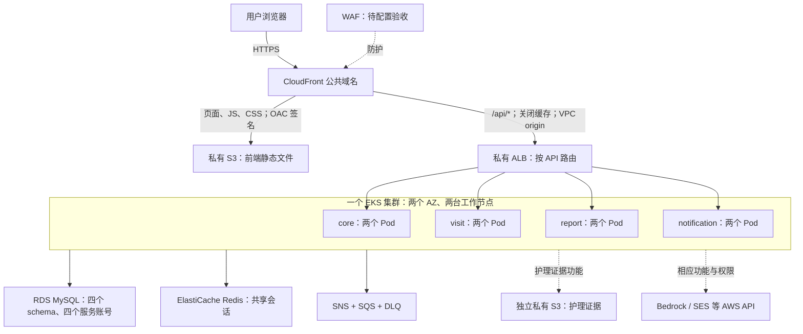

# CareLink 第二板块：最终部署方案与实施进度

更新：2026-10-13。目标仓库：`carelink-platform`。这是目标方案和本地交付准备，不是已经上线的公开环境。

## 采用的架构



React 在用户浏览器执行；S3 保存构建后的 HTML、JS、CSS，CloudFront 把它们送给用户。无需为当前静态 React 应用增加 Docker 镜像、前端 Pod 或 Nginx。四个 Java 服务仍然需要 Docker、ECR、EKS 和 Helm。GitHub Actions 已承担 CI/CD，不增加 Jenkins。

访问地址采用 AWS 提供的 `https://…cloudfront.net`。首次不需要购买域名。这个方案已经替代此前尚未上线的“前端 Pod + NLB + 数字 IP”选项。

ALB 通过 AWS Load Balancer Controller 根据 Ingress 创建。后端 Service 保持 `ClusterIP`，ALB 直接把请求送到相应 Pod；不把四个服务分别暴露到公网。CloudFront 的 VPC origin 支持新加坡区域及私有 ALB。[AWS VPC origins 文档](https://docs.aws.amazon.com/AmazonCloudFront/latest/DeveloperGuide/private-content-vpc-origins.html)

当前准备的协议是浏览器到 CloudFront 使用 HTTPS，CloudFront 到 S3 使用签名 HTTPS，CloudFront 到 ALB 使用私有 VPC 内的 HTTP。不能将它描述为每一跳都使用 TLS；若课程要求端到端 TLS，还需要补 ALB 证书及 HTTPS listener。

## 前端与后端如何交付

| 环节 | 前端 | 后端四服务 |
| --- | --- | --- |
| CI | npm 安装、lint、单元测试、build | Maven 检查、测试、打包与镜像构建 |
| 可部署产物 | `dist` 静态文件，提交号与文件 SHA-256 清单 | ECR 镜像，提交号与 image digest |
| 发布目标 | 私有 S3 前端桶 | 四个 ECR 仓库 |
| CD | 验证成功 main CI 的产物，上传 S3，刷新 CloudFront | 验证发布清单，Helm 部署四个服务 |
| runner | GitHub 托管 runner 即可 | 当前私有 EKS API 的演示部署使用临时 Mac runner |
| 回滚 | 选择之前成功 CI 的前端产物，再发布 | 选择之前的四服务镜像发布清单 |

此前前端并非没有 CI：原流水线已有 lint、单元测试和 build，缺的是产物保存与云端 CD。这次补的是这两部分。前端和后端允许分别发布；必须共同验收 API 兼容性。

暂时保留手动触发 staging 发布及部署开关，适合有限预算的演示窗口。这里的 CI/CD 不代表每次提交都会自动创建整套收费环境；Terraform 的基础设施创建与应用发布是不同操作。

前端发布脚本先验证整个产物，再上传资源文件，最后上传 `index.html`。不删除旧的带哈希资源，以保留旧页面和回滚的资源依赖；上传失败则停止。文件清单不上传到公开页面桶。产物在 GitHub 保留 7 天，超过期限不能直接用该 CI run 回滚，需要另行保留发布产物。

## 入口配置中的关键点

1. **前端桶私有。** 使用普通 S3 bucket 与 OAC，不开启公开 S3 website endpoint；CloudFront 只能读取指定前端桶。[AWS OAC 文档](https://docs.aws.amazon.com/AmazonCloudFront/latest/DeveloperGuide/private-content-restricting-access-to-s3.html)
2. **API 不缓存。** `/api` 与 `/api/*` 指向 ALB，转发 Cookie、查询参数、Authorization 和 CSRF 等请求头。API 错误保持实际状态，不统一替换为 `index.html`。
3. **React 深层链接可刷新。** CloudFront Function 仅将前端页面路径改写为 `/index.html`；缺失静态资源保留错误。`/internal`、`/actuator` 不对用户提供访问。
4. **四服务路由与仓库约定一致。** `/api/notifications` 去 notification，报表和增值服务去 report，访问执行及指定护理员路径去 visit，其余 `/api/*` 去 core。不能把全部 `/api/caregivers/*` 都送去 visit，因为请假、抽查等路径仍属于 core。
5. **登录通过同一公共域名。** 浏览器相对路径 `/api/...` 访问后端，Redis 继续保存共享会话。公开 HTTPS 配置启用安全会话 Cookie；CloudFront 覆盖 `Forwarded` 为 `proto=https`，应用只在这个受控私有入口启用 forwarded headers。公开登录、CSRF 写操作和退出仍待实测。

Ingress 使用 Controller 的正则路径匹配，以区分共享路径下的服务。安装前须核对选定 Controller 版本支持 `use-regex-path-match`，不能仅依靠 Helm 渲染成功。[Controller 注解文档](https://kubernetes-sigs.github.io/aws-load-balancer-controller/latest/guide/ingress/annotations/)

## 第二板块交付与协作

你负责让应用代码能够稳定进入云环境：网络、EKS、RDS 四库隔离、Redis、消息资源、服务身份、密钥注入、镜像和前端产物发布、部署及清理。此次公开入口的基础设施和发布准备也放在这个板块；路由与 WAF／域名／身份策略需要和入口板块共同确认。

业务同学提供各服务的迁移、健康接口、环境变量需求和业务验收用例；你可以提前准备基础设施与交付接口，和他们并行。你不需要等待全部业务代码完成，才能验证部署平台。只有真实业务链路验收必须等相应功能就绪。

护理证据使用独立私有桶，访问策略由服务身份与业务授权约束，不能复用前端桶的 CloudFront 公开读取策略。Bedrock、SES 的功能和服务角色权限由相应业务板块提出，不能因本次页面发布自动获得权限。WAF 已准备可选 Terraform 配置：一个 AWS Common Rule Set 和一个每 IP 每五分钟 2,000 次的限流规则；本轮预检查启用 WAF，但规则尚未在线创建或验收。

两个 AZ 和每服务两副本仅代表后端副本分布。之前验收使用单实例 RDS、单节点 Redis、单 NAT 的开发配置；尚不能宣称完整系统高可用。

## 本次已完成的本地准备

| 文件 | 用途 |
| --- | --- |
| `.github/workflows/ci.yml` | 保存静态前端产物与文件清单，保留原 CI 检查 |
| `.github/workflows/deploy-frontend.yml` | 独立前端 CD；默认因部署开关未开启而不运行 |
| `scripts/frontend-release.py` | 记录与校验产物；拒绝不一致文件、隐藏文件和符号链接 |
| `scripts/prepare-frontend-release.sh` | 仅下载本仓库成功 main CI 的指定产物 |
| `scripts/publish-frontend.py` | 核对 AWS 账号、桶与分发配置；资源先上传、入口最后上传 |
| `infra/public-site/` | 独立 Terraform 配置：私有桶、OAC、VPC origin、CloudFront、前端 OIDC 发布角色 |
| `charts/carelink-ingress/` | 私有 ALB Ingress 及四服务路由；需要提供审核后的子网与 CloudFront prefix list |
| `deploy/environments/public-https.yaml` | 四服务公开 HTTPS 会话设置；`PUBLIC_HTTPS=true` 时生效 |

Terraform 和账户配置继续只保存在本地。这批源码已获提交、推送和草稿 PR 授权，合并 main 与新收费窗口另行确认；GitHub 尚未执行新的前端 CD，AWS 没有创建新的公网入口资源。

前端发布角色只允许写指定前端桶及刷新指定 CloudFront，不增加原后端 ECR／EKS 发布角色的权限。管理员已完成本轮公开入口的两份角色权限上限、两份 Operator 策略、专用组及快照预览策略更新；组中只有 `carelink-dev`。Controller 和前端发布角色本身仍待 Terraform 创建。详见 `public-preview-permissions.md`。

## 上线顺序与成功标准

1. **一次性准备权限与资源计划。** 核对 Controller IAM、ALB／CloudFront 的服务关联角色、前端发布角色和 Terraform 状态权限；下一次数据库从最新平台快照 `carelink-staging-mysql-final-20261013-03` 恢复。新运行编号、Secret、恢复来源和最终快照范围一起审查，避免逐个失败再补权限。
2. **确认新的收费运行窗口。** 已结束的预览不再延长。费用包括原 EKS／节点／RDS／Redis／NAT，以及新 ALB、S3、CloudFront、可选 WAF。创建前重新估算并约定清理范围，不沿用上一轮未批准的 NLB 费用方案。
3. **创建后端并验收内部服务。** 恢复四库、部署四服务、检查健康及镜像版本；不要再导入旧单体数据库。
4. **安装 Controller、创建私有 ALB。** 实测所有共享路径的归属和目标组健康。CloudFront origin-facing managed prefix list 限制入站；创建 VPC origin 后核对实际连接与安全组。Controller 角色及运行资源尚未在本次配置中创建。
5. **创建 CloudFront 与前端桶，发布前端。** 为 `infra/public-site` 单独设置状态 key；提供 Active ALB 的 ARN／DNS。设置以下 GitHub variables，再开启前端发布：

   ```text
   AWS_ACCOUNT_ID
   AWS_FRONTEND_DEPLOY_ROLE_ARN
   CARELINK_FRONTEND_BUCKET
   CARELINK_CLOUDFRONT_DISTRIBUTION_ID
   CARELINK_FRONTEND_DEPLOY_ENABLED=true
   CARELINK_PUBLIC_HTTPS_ENABLED=true
   ```

   新成功 CI run 必须包含本次新增的静态产物；旧 CI 只有镜像和覆盖率文件，无法凭空补出这个产物。前端 CD 在 Actions 里选择该 run ID 手动运行。

6. **从其他设备验收公共 HTTPS 地址。** 关闭本机前端和 port-forward 后页面仍可打开；三角色登录、刷新深层页面、跨四服务读取、一个 CSRF 写操作与退出均通过；确认 Cookie 安全属性，API 不缓存且错误不被 SPA 吞掉，护理证据授权正确。随后验证前端回滚、WAF规则及公共地址扫描。
7. **清理并保留证据。** 先处理 CloudFront 对 VPC origin 的依赖，再删除 origin 和 Ingress／ALB；Controller 保持运行到 ALB 删除完成，随后清理 runtime。新的清理编排已完成并通过离线测试，真实删除仍待验收；静态桶及全部版本、WAF 和本轮前端发布角色到期删除，原三个快照与本轮最终快照保留。完整顺序与部分创建时的限制见 `public-preview-launch.md`。

## 当前云环境的实际状态

2026-10-13 21:00，新加坡时间，本轮 `20261013-03` 清理完成，总时长约 99 分钟，未超过四小时上限。EKS、节点及根磁盘、RDS、Redis、网络、消息资源已删除；五个 Secret 已进入恢复期。ECR、GitHub OIDC／交付角色、状态桶保留。

三个加密 RDS 快照均 Available：`20261012-01`、`20261013-02`、`20261013-03`。最新 `03` 保存的是平台四库和平台演示数据。独立核验记录位于被 Git 忽略的 `infra/.local/snapshot-preview-20261013/cleanup-verification.json`。

**目前没有运行中的公开网站。** 原 `127.0.0.1:15173` 已随预览关闭。下一轮上线必须重新创建后端，再完成这里的公开交付验收。

本轮 `04` 权限配置已完成；runtime 真实 plan 为 88 项创建，公开入口预检查为 13 项创建，均未 apply。公开入口 plan 中的 ALB 是占位值，禁止执行；须在真实 ALB Active 后重新生成。清理编排已通过 8 项离线测试，真实公共地址和云资源删除尚未验收；源码 PR 不代表环境已经上线。
