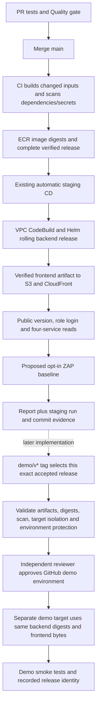

# ZAP baseline and demo promotion preparation

This PR prepares the remaining workstream 2 delivery controls in Proposal §5.5 and WBS 9.3. The existing main → staging backend/frontend automatic deployment and `https://dzfs8sv334fwf.cloudfront.net` remain unchanged. The new ZAP workflow is disabled unless an administrator later sets `CARELINK_ZAP_ENABLED=true`. Demo promotion is a reviewed design in this PR, not an enabled deployment workflow.

## What changes in this PR

| File | Purpose | Effect before enablement |
|---|---|---|
| `.github/workflows/security-baseline.yml` | Separate post-staging ZAP workflow | All scan jobs skipped while the flag is absent/false |
| `scripts/run-zap-baseline.py` | Verify successful staging acceptance and run a bounded passive baseline | Not called by existing deployment scripts |
| `scripts/tests/test_zap_baseline.py` | Offline source/scope validation | No AWS, Docker or website requests |
| This document | Activation, demo approval/promotion and acceptance design | No infrastructure or permissions changes |
| `devsecops-verification-20261017.md` | Dated GitHub/ECR findings | Records gaps without changing settings |

No edits to `ci.yml`, `service.yml`, `deploy.yml`, `deploy-frontend.yml`, Helm values, Terraform, existing IAM roles or deployment variables are needed for this preparation. Do not merge or enable this PR yet. No environment cleanup schedule is introduced.

## Existing and proposed delivery paths

## ZAP execution and boundaries

The prepared workflow listens to completion of `Deploy staging`; it also allows an explicit staging deployment run ID through manual dispatch. Both paths require main and `CARELINK_ZAP_ENABLED=true`. PRs, tags and forks cannot authorize a scan. The script rechecks repository IDs, workflow path, successful automatic deployment and the success of all four jobs: release, backend deploy, frontend deploy and public acceptance.

Before and after scanning, `/version.json` must match that deployment's full commit SHA. A mismatched version or redirect rejects the evidence. This detects a newer release arriving during the scan; it is not an atomic deployment lock, and a release that changes and changes back between checks is outside this guarantee. ECR digests remain in the source deployment's `staging-release` artifact; the ZAP report does not independently prove the running backend digests.

The first scope is unauthenticated public static pages and assets on the fixed existing CloudFront host. Context inclusion excludes `/api/*`, arbitrary application routes and other origins. No credentials, authenticated sessions, AJAX spider, active attack scan or full API scan are used. The traditional spider still makes HTTP requests: one thread, one-minute spider, depth 2, at most 20 children per node, no form processing, and a five-minute startup/passive-scan limit plus an outer process timeout. This is bounded baseline collection, not a load test or a guarantee of zero traffic impact.

The official stable scanner image is pulled, its immutable local image ID and registry digests are recorded, and the scan uses that resolved image ID. Scanner/container resource limits are 1 CPU and 2 GiB. GitHub credentials are not passed into the scanner container. The script removes its own local scanner container when the scan exits.

Reports: HTML, JSON, Markdown and `release-evidence.json`, uploaded even when the scan fails. Retention is seven days; download the accepted reports into the evidence package before expiry. Evidence includes the staging run/attempt, commit, target, scanner identity, timestamps and exit code. `completed` means reports exist; only `accepted=true` means exit 0 with matching pre/post versions. Findings are not suppressed: baseline exit 1 (FAIL), 2 (WARN) and scanner errors all fail this separate workflow. This result does not roll back or block the existing staging deployment.

This scope cannot prove authenticated-session safety, API authorization, business logic security or comprehensive SPA coverage. An authenticated/API scope requires separate test accounts, route/method review and an explicit follow-up change. Do not describe baseline success as a penetration test or a vulnerability-free website.

### Later activation and first acceptance

1. Review and merge this PR separately; leave the ZAP flag absent/false at merge time.
2. Confirm a controlled staging test window and the current fixed URL. Review scanner configuration and report retention. No IAM permission is needed by the new workflow.
3. Set `CARELINK_ZAP_ENABLED=true` only after that decision. Dispatch using a successful automatic staging run whose public commit is still current. Do not trigger a new application deployment solely to start this scan.
4. Inspect the complete report, covered URLs, exit code and version evidence. A warning remains a failed scan pending review/remediation. Do not add `continue-on-error`, `-I` or broad ignore rules to obtain a green result.
5. Check CloudFront/ALB health and request/error metrics during the first scan. This PR does not perform that live acceptance.
6. After the controlled first run, keep the flag enabled only if the team accepts scan-after-deploy operation. Setting it false prevents future starts; cancel any running scan separately.

## Demo promotion design

### Release selection and immutable artifacts

Use a protected `demo/v*` version tag pointing to a commit on main that has a successful automatic staging deployment, public acceptance and an accepted ZAP report for the same release. A tag alone is not evidence that staging passed. The future selection job must find and validate those specific runs and attempts using GitHub API metadata, same-repository/workflow checks and the expected SHA; never select an arbitrary most-recent successful run.

The candidate contains: tag, release commit, CI run ID, successful staging run ID/attempt, ZAP run ID/attempt, complete backend `release.json` and `inputs.json` provenance, exact frontend bundle/manifest, checksums, scanner findings and previous accepted demo release. Changed-only CI may reuse images from older commits whose inputs are identical. Preserve the complete manifest and provenance; do not incorrectly require all four image tags to equal the newest commit.

Promote each backend as `repository@sha256:digest`, not `latest` or a rebuilt tag. Publish the exact verified frontend bytes; do not run npm build again or modify the bundle after approval. The candidate must be sealed with a SHA-256 manifest before approval and revalidated afterward. Preserve it for the required demo/rollback period in a private, versioned artifact store; the current seven-day GitHub artifact retention is insufficient for a later demo if those artifacts expire. If trusted artifacts expire, stop; a rebuild is a new candidate requiring staging acceptance again.

### Isolated demo target before any deployment

The current CodeBuild buildspec explicitly runs `deploy-release.sh staging` and updates the current public ingress; the current trigger script only accepts the staging project. The frontend publisher also targets staging resources. **Do not point a demo workflow at these existing write paths or replace their repository variables.** The presence of demo Helm values alone does not make this a safe, deployable second environment.

| Component | Required demo separation | Preserve existing staging |
|---|---|---|
| Deployment executor | Dedicated demo CodeBuild project/buildspec and scoped trigger role | Do not reuse `carelink-staging-deploy` or relax its target checks |
| Kubernetes | Demo namespace, service accounts/RBAC, Helm releases, ingress and secrets | Do not upgrade staging releases or existing public ingress |
| Data and events | Demo-only database/schema credentials, Redis isolation and messaging destinations | Do not point demo writes/consumers at staging business data or queues |
| Frontend and edge | Separate private frontend bucket, distribution/origin and public URL | Existing CloudFront distribution, bucket and domain unchanged |
| Runtime configuration | Explicit demo endpoints/secret references and schema migration plan | No main deployment variable replacement |
| Capacity and cost | Plan resource changes, available node capacity and shared-cluster failure/CPU contention | Separate namespace is not complete capacity/fault isolation |
| IAM | Demo-specific OIDC/deploy rights restricted to approved environment/resources | No broadening of current staging roles |

A separate cluster is an option if strict resource isolation is required; it is not provisioned or selected by this PR. Any demo resources, shared-node capacity changes and associated cost require a subsequent reviewed infrastructure plan. Database/schema migrations are a separate compatibility decision; reusing the image does not make migrations automatically reversible.

### Approval enforcement

Before obtaining AWS credentials, the future workflow must read GitHub's `demo` environment and verify that it already exists, has at least one required reviewer, prevents self-review, restricts deployment to the intended version tags, and disallows administrator bypass where supported. Missing protection must stop the run. An `environment: demo` line alone can create an unprotected environment and is not an approval mechanism.

The deployment job itself then references `environment: demo`; GitHub holds that job before credentials are issued. Reviewer instructions must show the candidate checksum, all four backend digests, frontend checksum, staging/ZAP evidence, exact demo target and rollback candidate. After approval, recheck candidate checksums, environment configuration and exact target allowlists, then acquire the demo OIDC role. AWS trust must account for the environment subject `repo:Care-Giver-SE-Team2/carelink-platform:environment:demo`; the existing branch-scoped staging trust is not sufficient. Keep concurrency serialized for demo without cancelling an in-progress rollout.

This repository was public at verification time, so environment reviewer protection is available under GitHub's documented public-repository support. If repository visibility/plan changes, verify availability again. No environment, reviewer, tag rule, OIDC trust or branch-protection setting is created in this PR.

### Acceptance and rollback

The first future demo test must show: tag cannot bypass approval; a rejected approval performs no AWS writes; staging URL/version and automatic main deployment remain intact; demo runs all four selected image digests; demo frontend matches the selected commit/checksums; role login and four-service reads pass against demo; and the previous sealed candidate can be restored after its own approval without rebuilding. A failure stops demo promotion and retains evidence, rather than modifying staging. Rollback uses the prior full manifest and frontend bundle; if a database migration is incompatible, stop and use the reviewed data recovery plan.

## Team responsibilities and remaining decisions

Workstream 2 owns ZAP delivery integration and demo promotion (WBS 9.3). Workstream 1 coordinates repository protection/review policy and common pipeline maintenance. Workstream 5 owns ECR image-scan evidence and Terraform Checkov integration (WBS 9.2). Record the actual current branch approval count instead of assuming a Quality gate requires a reviewer.

Before implementation of demo deployment, the team must choose its isolated resource/data boundary and budget, identify required reviewers, define tag protection and candidate retention, and agree on migration/rollback compatibility. Keep Checkov, ECR scan-result blocking and unrelated business changes out of this preparation PR.

## References

- [ZAP baseline behavior, scope options and exit codes](https://www.zaproxy.org/docs/docker/baseline-scan/)
- [GitHub deployment environments and protection rules](https://docs.github.com/en/actions/reference/workflows-and-actions/deployments-and-environments)
- [Reviewing GitHub deployments](https://docs.github.com/en/actions/how-tos/deploy/configure-and-manage-deployments/review-deployments)
