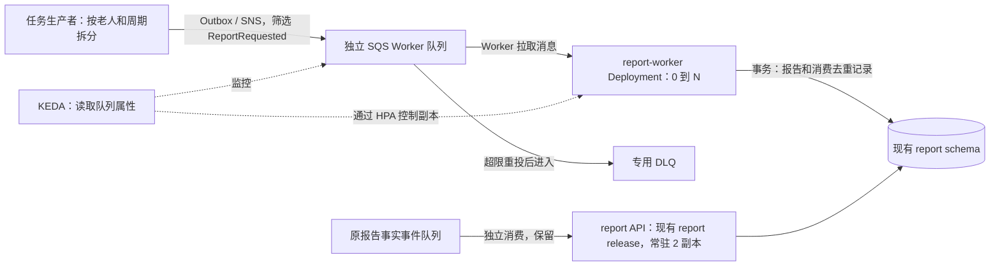

# Report Worker / KEDA 联合接入方案（待评审，未启用）

核验日期：2026-10-18。源码基线：`20e456a8191ce4fab437e6618d3169b2440f8a52`。
板块四来源：`CareLink_Part4_Checklist_PR55.pdf`（2026-10-18，三页）。

**2026-10-18 接入决定已补齐：请先读 [板块四接入约定 v1](keda/README.md)。**
下方保留核验时的缺口记录；任务粒度、SNS 入口、命名、参数和离线消息契约以 v1 约定为准。
板块二云端准备与板块四编码并行推进；交付包齐备后用户可自行验收，不要求队友全程在场。

本轮只读检查云端，并准备本方案与 review examples。没有执行 Terraform plan/apply、安装组件、
发送或接收测试消息、修改 IAM、合并 PR 或部署。Active-Standby 暂缓；PR #55 / #59 不变。
当前 CloudFront 网址和自动 CI/CD 保留，没有定时清理安排。

## 1. 当前真实状态与证据边界

只读采样从 `2026-10-18T08:57:33Z` 开始（新加坡时间 16:57）。使用 carelink profile，
确认身份为预期账号的 carelink-dev，未使用 root。原始投影保存在未跟踪的私有本地文件
`infra/.local/keda-readonly-20261018.json`；不上传其中的账号、队列地址、节点地址或身份 ARN。
没有读取 Secret 值或修改默认 kubeconfig。

| 项目 | 本轮观察 | 限制与下一步 |
| --- | --- | --- |
| EKS 节点 | 两台 t3.large，分别位于新加坡 1a / 1b，均 Ready | 不是峰值负载或单 AZ 故障容量证明 |
| metrics-server | Deployment 2/2；节点 Metrics API 返回数据 | CPU/memory metrics 不代表 KEDA 的 external metrics 已安装 |
| 报告 API | 现有 release 名为 report，desired=2，ready=2 | 未发现独立 report-worker Deployment；本轮未读运行 Secret，不能证明最终有效 profile / scheduler 开关 |
| KEDA | 未发现 KEDA Deployment；ScaledObject CRD 与 external metrics API 返回 NotFound | 未启用，不能标记为云端扩缩容验收通过 |
| Pod Identity | 查询到 controller 和四个现有业务 ServiceAccount 的关联 | 未发现 worker / keda 关联；不等于已完成所有 IAM policy / boundary 审查 |
| 报告事实队列 | 已知 report 队列与 DLQ 可读取；采样均无 visible / in-flight 消息 | 原队列 visibility=300s，maxReceiveCount=5，SQS 托管加密已启用；采样空队列不是事件链路验收 |
| 拟用 Worker 队列 | 对 carelink-staging-report-worker 和对应 -dlq 的指定 URL 查询返回 NonExistentQueue | 仅针对这两个拟定名称；不能断言账号中不存在其他命名的 Worker 队列 |
| 全量队列 / 节点组清单 | ListQueues / ListNodegroups 被 AccessDenied | 不能将权限拒绝当资源不存在；未扩大权限。节点组上限仍待核验 |

节点 requests 预算（由本轮已分配的非终态 Pod 计算，包含普通 init container 的最大 requests 与 Pod overhead）：

| AZ | Allocatable CPU | 已请求 CPU | requests 余量 CPU | Allocatable 内存 | 已请求内存 | requests 余量内存 |
| --- | ---: | ---: | ---: | ---: | ---: | ---: |
| 1a | 1930m | 900m | 1030m | 7078.5 MiB | 2574 MiB | 4504.5 MiB |
| 1b | 1930m | 1000m | 930m | 7078.5 MiB | 3086 MiB | 3992.5 MiB |

采样中 report 有三个非终态 Pod，包含不同 rollout revision，因此不是稳态八副本快照。
部分系统容器没有 requests，上表也不包含待安装 KEDA、未来 Worker、额外 rollout surge 或业务峰值。
不能将余量全部分配给 Worker，或据此批准 maxReplicas / 单 AZ 故障承载能力。
后续固定测试提交并等待现有发布稳定后，重新核对 requests、实际使用、IP/Pod 配额、
KEDA 组件 requests、数据库连接数以及 AI 并发/限额，再确定最大副本数。

## 2. 板块四按 v1 任务契约实现

目前 `ReportRequestedHandler` 根据 occurredAt 计算前一完整周，并调用
`prepareBatch(null, period.start(), period.end(), null)`；payload 尚未用于选择某位老人。
重复投递多个新消息 ID、但仍处理同一批老人，不能证明有效并行，可能重复执行 AI 准备阶段。

| 队友需要提供 | 验收内容 |
| --- | --- |
| 消息 JSON 与版本策略 | 按 v1 README 与消息样例：payload.schemaVersion=1、elderId、periodStart、periodEnd、runId；当前 main 尚未实现该契约 |
| 任务粒度 | 一位老人 + 一个明确完整周为一条任务，一次生成全部现有 audience |
| 业务唯一键 | 与现有 elder + audience + period 唯一约束对齐；说明重复与并发冲突如何处理 |
| 任务生产者 / fan-out | report API 侧生产者枚举老人，经既有 Outbox/SNS 发布；首次测试可受控发布同格式 SNS 消息，不能冒充已完成的每周定时链路 |
| 旧批任务迁移 | API 与 Worker 均关闭旧周报 timer；启动配置调整与新生产者切换应避免漏跑或双跑；回退时不能同时保留两条生成路径 |
| 测试数据和 SQL | 多个独立老人/周期、预期报告数量/内容、重复任务判定、生成前后验证 SQL，以及业务数据清理范围 |
| 运行限制 | 单任务最长时间、每 Pod 并发、DB/HTTP/AI 超时重试上界、停止接新任务及退出行为 |

板块四负责 Java 契约、任务拆分、正确性和测试夹具。板块二不接手报告业务开发。
目前可靠性测试的结论来自队友本地 Maven / Docker / MySQL / LocalStack 记录；本轮没有重跑，
也没有把这些记录认定为真实 AWS / EKS / Bedrock 验收。

## 3. 拟议调用与控制关系

KEDA 不消费任务，消息由 Worker 拉取。Worker 不新增公网 Ingress，也不加入现有 report HTTP
Service 的选择器。原 CloudFront / WAF / ALB、RDS/Redis、事实队列与现有四服务发布保持原身份。

## 4. Terraform / Helm / CD 变更设计

本节是变更计划，不是已经执行的 Terraform plan，没有“0 replacement”或云端安装完成证明。
当前 examples 位于 docs/testing/keda，现有工作流不加载这些文件。

| 层 | 拟修改入口 | 限定范围和审查条件 |
| --- | --- | --- |
| Terraform | infra/runtime/messaging.tf，或同 root 的独立 report-worker.tf | 新增显式默认关闭的 Worker 接入开关；专用 SQS/DLQ、加密、redrive 限定；不把 worker 无条件加入现有四服务集合 |
| 消息路由 | 既有 SNS topic 新增订阅 | 只筛选 ReportRequested，raw delivery 与现有 Envelope 匹配；不改原 report 事实事件过滤器 |
| Worker IAM | 专用角色、boundary、staging/report-worker Pod Identity | 仅该队列 ReceiveMessage / DeleteMessage / ChangeMessageVisibility；若 SDK/应用确需 GetQueueAttributes / GetQueueUrl 再限定添加。SNS Publish / Bedrock 权限按实际代码单独审查，不直接复制 API 的全部权限 |
| KEDA IAM | 独立 KEDA operator 身份与关联，namespace=keda | 对指定 Worker 队列只读属性；不授予收取/删除消息、数据库或 Secret 读取权限；先核对 boundary / PassRole / 信任限制，不使用静态 access key |
| Helm Worker | 独立 release / labels / ServiceAccount，复用 report 镜像 | SPRING_PROFILES_ACTIVE=worker；保留 servlet 健康探针；专用 runtime Secret 引用现有 report DB 凭据与 CA 信任，不复制明文密码；无公网路由 |
| API | 保留现有 report release / Service / 两个副本 | 评审后切换 api profile、关闭旧 timer，继续消费事实事件；不能重命名 release 使现有路由失效 |
| Helm 副本管理 | charts/carelink-service/templates/deployment.yaml / hpa.yaml 或独立 Worker chart | 增加经测试的 KEDA 管理模式：省略 Deployment replicas，但不生成 CPU HPA；保留四个既有服务的默认渲染结果。当前 autoscaling.enabled=true 会生成 CPU HPA，不能直接用它代替 KEDA 模式 |
| KEDA 安装 | 单独受评审的 Helm 组件安装配置 | 锁定兼容版本和 requests；评审 operator/metrics/webhook 的 RBAC 与身份。不能因 metrics-server 存在就跳过 KEDA metrics 安装检查 |
| KEDA ScaledObject | 独立、默认不启用的 Worker 配置 | 只指向 report-worker；min=0；最大副本依容量批准；计入 in-flight，但不能将它当成绝对不会中断任务的保证 |
| Secret 同步 | scripts/sync-runtime-config.py | 现脚本只识别四服务，必须显式增加 Worker 最小配置并验证队列，不能复制 report-runtime 后误消费原队列；保留 TLS、隐藏敏感输出 |
| 自动 CD | scripts/deploy.sh、release/check scripts、deploy/codebuild/buildspec.yml 等实际路径 | Worker 映射到 release manifest 的 report 镜像 digest，而不是构建不存在的第五份镜像；与 API 同版本发布；兼容增量复用、回滚、首次可选启用和 scale-to-zero，不能通过关闭现有自动 CD 绕过问题 |

特别注意：deploy.sh 会枚举 services/*/deploy/values.yaml。直接在该路径新增 Worker values
可能被既有自动 CD 自动发现，随后却按第五服务查找不存在的镜像记录。因此此次只放 docs 示例，
不创建该自动发现路径，也不改 workflows、运行 Chart 或 Terraform。

### 退出与任务续租

当前 QueueConsumer 的 Worker 等待上限为 240s；续租每 60s 延长 180s。
现有通用 Chart terminationGracePeriodSeconds=40、preStop=10s，不能照搬给 Worker。
Worker values review 示例暂用 270s 总退出预算，并显式列出 240s Spring lifecycle 参数；
这些是待测候选值，必须覆盖实测处理/提交/退出流程，不能承诺超过预算的任务仍不被中断。
Spring lifecycle 超时是按 shutdown phase 生效，不是整个进程退出的统一上限；需测量实际阶段
与同步 stop 的耗时，必要时调整总退出预算，不能仅用 240 + 10 的加法当完成证明。
终止、缩容或失去续租时仍需以重投和业务幂等兜底；允许的重复 AI 成本也应记录。

## 5. 四轮联合测试与停止条件

先固定提交、镜像 digest、测试老人/周期、双方时间窗口、任务数量上限、AI 成本上限和恢复负责人。
第一轮建议使用现有 AI disabled 路径（CARELINK_REPORT_AI_ENABLED=false），不能称为真实 Bedrock 验收；
真实 AI 调用另定配额和费用。测试环境必须与真实业务数据明确隔离，并先确认共享 DB 的边界。
v1 已定义首轮最多 10 条任务、max=1 后再放开到 2、AI disabled、每轮 30 分钟；
实际启用仍需板块二完成容量和云端评审、选定运行窗口，本轮不直接发送消息。

| 轮次 | 双方步骤 | 通过标准与证据 |
| --- | --- | --- |
| 1 固定一个 Worker | 先部署独立 Worker；队友提交一条隔离任务；双方跟踪同一 taskId | SQS→Worker→DB 正确；提交后删消息；API 的事实队列不受影响 |
| 2 0→1→0 | 完成 KEDA 启用评审后，从空队列和零 Worker 开始，发送一个独立任务 | 记录入队、desired/ready、开始处理、提交、删消息、缩回零；启动延迟不是纯 KEDA polling 时间 |
| 3 0→N→0 | 在批准的副本上限内发送多个真实独立任务 | 多 Pod 实际分担任务、积压消退；所有结果正确，无不可接受重复副作用；不能只观察副本数 |
| 4 中断恢复 | 先定位正在处理隔离任务的 Worker，再受控 SIGTERM / 强制终止 | 在预算窗口内重新投递并完成；记录重复处理/AI 调用、DLQ、DB 唯一约束结果；不终止 API 或节点 |

采集：UTC 统一时间轴，SQS visible / in-flight / delayed / DLQ / oldest-age，
Worker desired / ready / Pending 原因、Pod CPU/内存、KEDA/HPA 状态，任务成功/失败/重投/去重，
任务等待/处理/端到端耗时，任务 ID 对应的 SQL 验证；分清业务唯一结果与执行次数。
SQS 属性与 CloudWatch 可能近似/延迟，按各采样时间记录，不要求同一秒精确相等。
既有 PR #55 的 visit 采集工具不能直接当作 SQS / Worker 已采集完成，需要补充适配。

停止条件：触及批准费用/并发/任务数上限；持续 Pending；API 登录/业务探针失败或延迟超出
约定阈值；DLQ 出现非预期任务；重投/重复副作用异常；无法读取伸缩指标。首轮阈值见 v1 README。

恢复顺序：停止测试生产者；先明确是否让在途任务排空；通过经评审的伸缩暂停/固定 Worker
方式恢复受控运行；保留队列、DLQ和证据以便核验，不能 purge 队列或自动删除未完成任务。
若回退应用，API 与 Worker 按同一 release 的兼容镜像回退；副本与 ScaledObject 所有权一起处理。
结束后验证原网址、角色登录、原事件消费与自动 CD；不执行环境清理或创建定时清理安排。

## 6. 进入启用评审前的勾选项

- [ ] 板块四给出消息契约、拆分实现、生产者、重复与异常恢复测试、SQL；不是只给口头确认。
- [ ] 原 timer 迁移与回退方案；API 两副本及 Worker 队列隔离可验证。
- [ ] 核对原状态与私有输入，生成真实 Terraform plan；不得替换/删除既有数据、网络或入口。
- [ ] Worker / KEDA IAM、boundary 和部署执行器权限均经过限定审查。
- [ ] Worker 配置、Secret、CA、profile、健康探针、退出预算完成离线与单 Worker 验证。
- [ ] KEDA 管理 replicas 与正常发布/回退/增量复用经过测试；原四服务渲染保持兼容。
- [ ] KEDA 组件 requests、节点余量、峰值/故障余量、DB/AI 限额确定，批准 maxReplicas。
- [ ] 测试窗口、任务与费用上限、停止阈值、恢复负责人、证据字段均填写。

状态在完成四轮前保持 **Under Integration / Pending Validation**。
Active-Standby 不在本次接入范围；不能以 KEDA 或 SQS visibility heartbeat 代替选主验收。

## 参考（版本与机制，不是部署批准）

- [KEDA SQS scaler：队列长度与 in-flight 计算](https://keda.sh/docs/2.21/scalers/aws-sqs/)
- [KEDA Deployment scaling 与暂停](https://keda.sh/docs/2.21/concepts/scaling-deployments/)
- [AWS：EKS Pod Identity 与 KEDA 参考模式](https://docs.aws.amazon.com/prescriptive-guidance/latest/patterns/event-driven-auto-scaling-with-eks-pod-identity-and-keda.html)

参考模式中的示例广域策略不直接复制到 CareLink；最终以指定队列的最小动作和既有权限边界为准。
