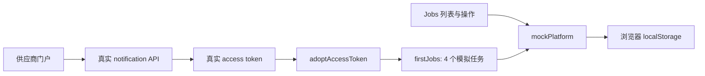

# CareLink Partner Portal　(PT01 / PT04)

**Owner:** Section 5 (notification)

This is the **PT04 provider workbench** of the brief and WBS, named the Partner Portal in the UI.

Where third-party providers join the CareLink Open Platform, at `/provider`. It is public (no
CareLink login) and talks **only** to the public provider API in
`features/provider-platform/api.ts`; `publicApiOnly.test.ts` fails the build if a file here
imports `shared/api`, the login or `RequireRole`.

In production an integrated provider works in **its own system**: CareLink sends it jobs by
webhook and its server answers through the job API. So this portal is CareLink's side of that
relationship, as developer portals are elsewhere:

| Page | What it's for |
|---|---|
| Apply | Joining (PT01); also creates the portal account: the contact email and a password |
| Status | Sign in; then the application and CareLink's decision |
| API credentials | The client ID and secret, shown once; afterwards a hint, how a server uses them, and Rotate secret |
| Webhooks | The endpoint and its events, the signing secret (rotate), Send test event, and CareLink's delivery log: every attempt, retries, failures, Resend |
| Sandbox | The job API tried by hand: get a token, accept, decline, complete. What the provider's server would do; it keeps PT04's onboard → accept → complete demonstrable without a partner system |
| Docs | Token, webhook verification and job calls in one page (a draft until the Open API contract) |

The header shows the provider and how its webhooks are doing; the manager console's Providers
screen shows the same health and can suspend a provider.

Design: the "provider workbench" handoff (v3, manager-console style), extended in the same
language for the portal pages. The controls are in `components/ui.tsx`, because the shared
components are sized for the manager console.

## What is real and what is mocked

`features/provider-platform/api.ts` is the portal's only way to CareLink. Run with the backend
(`scripts/run.sh all`, then `npm run dev`), it calls the Open API that notification serves
(`liveApi.ts`, docs/api/open-platform.yaml): applying, the portal, credentials and webhooks are
real, and real webhooks are sent and logged. Signing in and getting tokens are notification's
too: it issues the tokens itself, the same locally and in the cloud (docs/section5/decisions.md,
D15). Every call is under `/api/open/v1`, which CloudFront sends to the services as it does all of
`/api`; locally the Vite proxy sends `/api/open` to 8083.

The live job API is not connected. In publishable builds both the Sandbox list and direct job
detail routes show **Job integration is not available yet**, without a token form or job action
buttons. The five job functions reject locally with `501 jobs_not_available`; this is a capability
error, not an HTTP response from report. Real token issuance still works, but its token is never
handed to the mock. After confirming one-time credentials, live mode clears the secret instead of
keeping a Sandbox prefill that cannot be consumed; local mock mode still supports that prefill.
Applying, portal sign-in, credentials, webhook management and the manager's
provider screens retain their real API paths. A newly queued webhook can have no attempts yet;
the delivery log shows “Awaiting first attempt” until the scheduler records a response.

Under Vitest, and in local development with `VITE_OPEN_PLATFORM_MOCK=true`, every provider call
uses the mock in localStorage, with the seeded providers below. `npm run build` rejects that flag
and rejects a bundle containing used mock exports or mock storage state. The existing CI invokes
this build command; no deployment workflow, environment, URL or cloud configuration changes here.

Providers sign in with the contact email and the password set when applying; notification keeps
only a bcrypt hash of it, and five wrong passwords in a row lock the sign-in for 15 minutes. Not built, and to settle with the contract: MFA,
password reset, team members, and approval emails (no email channel, docs/section5/decisions.md, D9).

## Local mock demo

From `frontend`, run `VITE_OPEN_PLATFORM_MOCK=true npm run dev`. This mode is for local
demonstration only; do not point it at the public staging site or publish its assets. The steps
below describe simulated jobs, and must not be presented as backend persistence or webhook evidence.

1. `/provider/apply`: submit an application, setting a password. You're signed in to the
   portal; Status shows it pending.
2. `/manager/providers` (signed in as a manager, in another tab): approve it.
3. `/provider/status`: **Check again**, then **View credentials →** (shown once) →
   **Continue**.
4. `/provider/webhooks`: **Send test event**; open the delivery. With the endpoint the
   provider gave, the attempts show what it answered; on the mock, the jobs' deliveries too.
5. `/provider/sandbox`: **Get access token** (filled in from step 3), open a job, **Accept
   job**, then **Mark complete**. One new job is cancelled by the family as you accept it, to
   show the 409 path. These jobs and their state changes exist only in the local mock.
6. Back on `/manager/providers`: the provider's health, and **Suspend provider**: its
   webhooks stop and Status shows it. On the mock the Sandbox then gets 403; with the backend,
   that comes with report's job API, which refuses a suspended provider's token.

On the mock, a provider approved in the seed data, with a failed and a retrying webhook, for
skipping steps 1–3 (sign in on Status). These are mock values, valid only against the mock:

| | |
|---|---|
| Portal sign-in | `partners@brighthome.sg` / `brighthome-demo` |
| Client ID | `cl_prov_BrightHome9` |
| Client secret | `cs_demo_brighthome` (until you rotate it) |

Other seeded accounts: `alvin@quickclean.sg` / `quickclean-demo` (rejected),
`ops@kampungcare.sg` / `kampungcare-demo` and `daniel@freshcart.com.sg` / `freshcart-demo`
(pending).

To start only the local provider mock over, remove `carelink.mock.providerPlatform.v1` from
localStorage and `carelink.workbench.session` / `carelink.workbench.token` from sessionStorage,
then reload. Do not clear unrelated application storage.

## Jobs 依赖审核与分阶段隔离方案（2026-10-18）

本节比较审核基线 `902fd4b` 与本 PR。PR 尚未合并时，公网仍保持基线的混合实现，
不能将下面的候选隔离行为当作已经上线。

| 链路 | 基线实际实现 | 本 PR 候选行为 |
|---|---|---|
| 供应商申请、登录、申请状态、凭据和 Webhook | `api.ts → liveApi.ts → /api/open/v1/* → notification` | 保留真实调用 |
| 管理员审核供应商 | `providerApplications.ts → shared/api → /api/provider-applications` / `/api/providers` | 保留真实调用；正式构建强制 live 分支 |
| 获取 client-credentials token | 真实 token 接口之后，`adoptAccessToken` 将 token 复制到 mock | 只返回真实接口的结果，删除 mock 桥接 |
| Jobs 列表、详情 | `api.ts → mockPlatform.listJobs/getJob`；没有 Jobs HTTP 请求 | 正式构建明确不可用；本地 mock 保留 |
| 接受、拒绝、完成 | `mockPlatform` 仅修改浏览器数据，`once()` 仅模拟幂等；不是数据库事务 | 正式构建不提供这些动作，API 层同时拒绝直调 |
| 初始化任务 | `adoptAccessToken → firstJobs` 为真实 client 生成 4 个假任务 | 正式构建不生成任务 |
| 存储与事件 | mock 数据、令牌和模拟投递存于 `carelink.mock.providerPlatform.v1`；不是 SNS/SQS 消费证据 | 正式代码不读写此键；既有浏览器数据不会自动删除 |

基线调用链：

候选隔离后，正式构建仍可管理申请、凭据和 Webhook，但 Jobs 显示能力状态，不会伪装成请求成功。
本地开发与测试仍覆盖模拟的列表、分页、取消竞争、幂等和状态流转。此 PR **尚未实现真实 Jobs 后端**，
也没有创建新的 demo 环境或更改 staging 自动发布开关。

### 后续真实 Jobs 接入：与队友确认后再实现

- **report Owner / 板块四**：以 `docs/api/open-platform.yaml` 的 `x-served-by: report` 为起点，
  确认 `/api/open/v1/jobs`、`/{jobId}`、`/accept`、`/decline`、`/complete` 五项操作的真实
  Controller、持久化模型、真实任务来源和数据库状态机；目前源码中未找到这些 Jobs Controller。
- **Open Platform Owner / 板块五**：确认 issuer/JWKS、audience、`open-platform/jobs.read` /
  `open-platform/jobs.write`、client 与 provider 的归属、过期/暂停后的拒绝规则。不能依赖浏览器本地
  `authorise()` 代替服务端授权。
- **前端与 report Owner**：确认 camelCase 请求字段、状态/分页/错误码转换。门户 Docs 页仍有旧版
  `/v1/jobs`、token URL 和 scope 示例；它已注明未启用，接入前须与 OpenAPI 一起统一，不能照抄为线上地址。
- **业务与事件 Owner**：将 dispatch/cancel 事件、providerId/jobId、真实 Webhook 投递及服务请求关联起来；
  浏览器模拟的投递记录不算真实事件链路通过。
- **板块二配合**：接口确定后只核对现有 `/api/open` 路由、服务环境变量、安全配置和真实请求证据；
  此阶段没有理由重建 CloudFront、ALB、EKS 或创建 demo。

### 启用真实 Jobs 前的验收门槛

1. 两个独立供应商账号验证数据隔离；跨 provider 读取/操作被拒绝；过期、暂停和 scope 不足被服务端拒绝。
2. 从真实服务请求生成 job，完成 `NEW → ACCEPTED → COMPLETED`；重复 Idempotency-Key 不重复执行，
   取消竞争、非法状态、拒绝与重试均有数据库和 HTTP 证据。
3. 清空该功能的本地测试状态或换浏览器后，仍能从服务端读取同一个真实 job；Webhook 记录和数据库能对应。
4. 将 `liveApi.ts` 接入真实 Jobs 并替换本 PR 的能力提示，测试证明未加载 mock；先 PR 审核，再决定合并。
5. 生产构建检查、真实门户回归、角色页面及严格 CSP 验证通过后，沿用现有自动 CI/CD 和同一公网网址。

旧浏览器 localStorage 可能仍含基线留下的 mock 状态和旧令牌。本 PR 停止使用它，但不自动迁移、
删除或把其中的演示任务导入数据库。需要清除时只处理上述三个功能专属键，不使用 `localStorage.clear()`。

既有发布脚本会保留旧哈希资源以兼容已打开的页面和回退，因此本 PR 不会删除历史 JS/CSS 或清空 CDN。
隔离结论针对新正式构建；旧资源或旧标签页仍可能含之前的演示内容，这不等于已经清除了全部历史副本。
